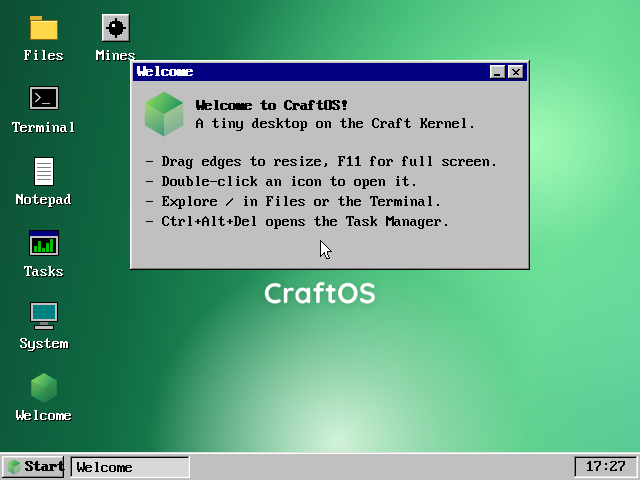
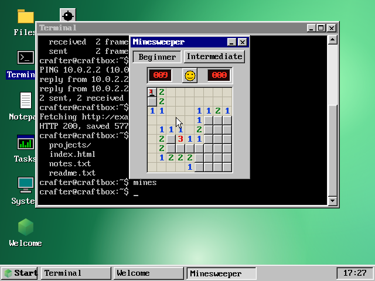
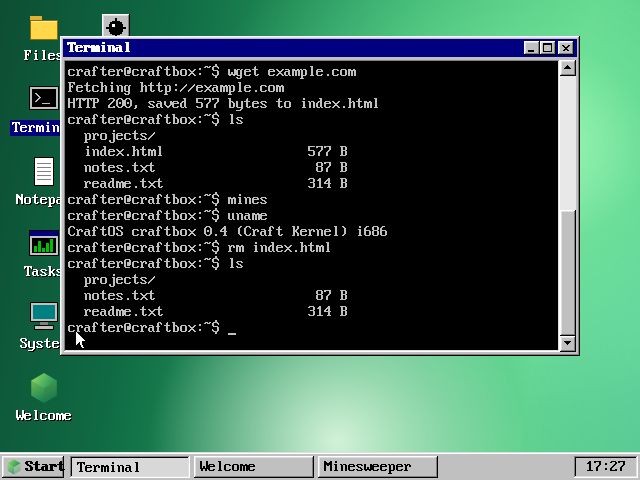

# CraftOS (Craft Release 1)

CraftOS with the first version of its desktop: grey beveled windows and buttons, navy title bars,
a grey taskbar, and the VGA text font. It has the original apps plus Minesweeper, and plain HTTP
networking in the shell. There's no web browser (no HTML, CSS or JavaScript) and no HTTPS. The
kernel on its own is next to it in `../Craft Kernel`.

CraftOS runs on the Craft Kernel, a hobby x86 (32-bit) kernel written from scratch in C with a
little assembly. It boots through Multiboot, so QEMU can load it directly without a disk image.

CraftOS always boots into a text-mode shell. Type `ui` to start the desktop, a simple one in
the style of mid-90s operating systems , and use Start > Text Mode (or `ui exit` in its
terminal) to come back. Underneath both is a preemptive multitasking kernel with a task
manager, and a RAM disk laid out like a Linux system, the CraftOS way.







## What it does

- Sets up its own stack and calls `kernel_main` (`src/boot.S`)
- Flat GDT, IDT with all 32 CPU exceptions, and the 8259 PIC remapped to vectors 32-47
- PIT timer at 100 Hz, PS/2 keyboard and wheel mouse drivers, and the CMOS real-time clock
- Preemptive multitasking: kernel threads with their own stacks, switched round robin on
  every timer tick, plus an idle thread, sleeping, waiting for input, and per-task CPU use
- Networking: a driver for the RTL8139 network card, and a small IPv4 stack on top of it
  (ARP, ICMP, UDP, DHCP at boot, DNS and TCP), with an HTTP/1.1 client for plain `http://`
- A shell that runs both on the text console and in the desktop's Terminal app. Commands
  live in `/bin`, so `help` lists that folder:
  - files: `ls`, `cd`, `pwd`, `cat`, `echo ... > file`, `mkdir`, `touch`, `rm`, `mv`
  - tasks: `ps`, `kill`, `pause`, `resume`, `sleep`, `taskman`, plus the background programs
    `spin`, `primes` and `ticker`
  - system: `ui`, `uname`, `whoami`, `hostname`, `date`, `uptime`, `free`, `clear`, `crash`,
    `reboot`, `shutdown`
  - network: `ifconfig`, `dhcp`, `ping`, `host` (DNS lookup) and `wget` (saves an `http://`
    page to a file). In the desktop's Terminal these run as a background job, so the desktop
    keeps going while they wait
  - desktop only: `edit`, `files`, `view`, `mines`, `exit`
- 640x480 32-bit graphics through the Bochs VGA interface, double-buffered and clipped, and a
  clean switch back to 80x25 text mode (VGA registers and font restored)
- A desktop with:
  - icons that open windows on double-click
  - windows you can drag, resize from the right or bottom edge (or the corner), minimize to
    the taskbar, maximize (button or double-click the title bar) and close
  - F11 full screen for the focused window, covering the taskbar
  - scrollbars with arrow buttons, page clicks and a draggable thumb, plus the mouse wheel and
    the Up, Down, PgUp and PgDn keys
  - a taskbar with a Start menu, one button per open window, and a clock
  - Text Mode, Restart, and Shut Down, which powers off QEMU, Bochs and VirtualBox
- Apps:
  - **Task Manager** (Ctrl+Alt+Del): every task with its PID, state, CPU use, CPU time and
    status, and buttons to end, pause or resume one, or start a background program
  - **Terminal**: the shell, with a `crafter@craftbox:~$` prompt and scrollback
  - **Files**: browse folders, make new folders and files, delete, and double-click to open
  - **Notepad**: edits RAM disk files directly, so changes are saved as you type; read-only
    and live files open as a view
  - **Minesweeper**: Beginner (9x9) and Intermediate (16x16), a safe first click, right-click
    flags, double-click a number to clear around it, a mine counter, a timer and a face to restart
  - **Image Viewer**, **System** (memory, uptime) and **Welcome**
- A RAM disk (256 entries; files keep their first 4 KiB in place and can grow to 1 MiB) with
  read-only files, live files that are generated each time they're read, and blobs (read-only
  files of any size, like images)
- Status icons (info, question, warning, fail) in dialogs: the kernel task warning, Restart and
  Shut Down confirmations, and error messages from Files, the Task Manager and the Image Viewer
- Images: the CraftOS wallpaper, the Craft cube icon and the status icons are built into the
  kernel as `.cimg` files under `/usr/share`, decoded at runtime and drawn with alpha blending
- If the desktop crashes, the exception handler switches back to text mode to show the panic

## The network

QEMU's `-nic user,model=rtl8139` (already in `make run`) gives CraftOS its network card and a
private network with a DHCP server. At boot it gets an address (10.0.2.15 under QEMU); `dhcp`
asks again. Then, for example:

```
ifconfig
ping 10.0.2.2
host example.com
wget example.com
cat index.html
```

`wget` follows redirects and names the file after the last part of the address (or
`index.html`); `wget URL FILE` picks the name. Pages come back as they are, since there's no
HTML here. `https://` addresses are refused: HTTPS came in a later release. QEMU's own address,
10.0.2.2, is the computer running it, so a web server there (`python -m http.server`) can be
fetched with `wget 10.0.2.2:8000`.

## Tasks

`ps` (or `cat /proc/tasks`) shows something like:

```
  PID  STATE     CPU   TIME  NAME        INFO
    0  ready      0%   0:02  idle
    1  running    0%   0:00  shell
    2  ready     50%   0:02  spin        1030700k loops
    3  ready     50%   0:01  primes      379660 found, latest 5482297
    4  sleeping   0%   0:00  ticker      3 ticks, see /tmp/ticker.log
```

- Pid 0 is the idle thread, and pid 1 is the kernel's own thread, which runs the shell and the
  desktop (it's renamed `desktop` while the desktop is up). These are kernel tasks: they can't
  be paused, and trying to kill one brings up a warning first (a dialog in the desktop, a y/n
  question on the text console). Saying yes really does it: killing pid 1 panics the kernel,
  and killing pid 0 leaves the CPU spinning whenever nothing else needs it.
- `spin`, `primes` and `ticker` are background programs: typing the name starts one. A network
  command run in the desktop shows up as a task of its own while it works.
- Open desktop windows are listed as `app` tasks. They run inside the desktop's thread, so
  they can't be paused, but ending one closes its window.
- `kill`, `pause` and `resume` take PIDs or names.

## The file system

| Folder           | What's in it                                                          |
| ---------------- | --------------------------------------------------------------------- |
| `/bin`           | One read-only file per command and program, holding its usage line    |
| `/boot`          | `craft-kernel.info`: where the running kernel was loaded and its size |
| `/dev`           | `null` (swallows writes), plus live `clock` and `mouse`              |
| `/etc`           | `hostname` (edit it to rename the machine), `motd`, `os-release`      |
| `/home/crafter`  | Your home folder, `~`: `readme.txt`, `notes.txt`, `projects/`        |
| `/proc`          | Live `version`, `uptime`, `meminfo`, `cpuinfo` and `tasks`            |
| `/tmp`           | Scratch space (`ticker` writes its log here)                          |
| `/usr/share/doc` | `keys.txt` and `layout.txt`                                           |
| `/var/log`       | `boot.log`, the real messages from this boot                          |

Everything outside `/home/crafter`, `/etc`, `/tmp` and `/var` is read-only. It all lives in
RAM, so it resets on every boot.

## Images

The images come from `../../../Craft Assets` and are converted ahead of time into CraftOS's own
`.cimg` format (in `assets/`), which `src/assets.S` builds into the kernel. To change one,
convert it again and rebuild:

```sh
python tools/img2cimg.py "../../../Craft Assets/CraftOS Wallpaper.png" assets/wallpaper.cimg --size 640x480 --fit cover --format rgb
python tools/img2cimg.py "../../../Craft Assets/craft-block-1x1.png" assets/craft-32.cimg --size 32x32 --trim
```

The converter only needs Python's standard library. `--format rgb` suits photos and gradients,
and the default run-length format suits icons.

## Building

One-time setup, on Ubuntu (or WSL Ubuntu):

```sh
sudo apt update && sudo apt install -y build-essential gcc-multilib qemu-system-x86
```

or on Fedora:

```sh
sudo dnf install -y gcc make binutils glibc-devel.i686 libgcc.i686 qemu-system-x86
```

Then, from this folder:

```sh
make          # builds build/craft-kernel.elf
make run      # boots it in a QEMU window, with the network card
```

If no QEMU window shows up from WSL, install QEMU for Windows and run
`qemu-system-i386 -kernel build/craft-kernel.elf -rtc base=localtime -nic user,model=rtl8139`
from this folder.

## Layout

| Path               | What it is                                                   |
| ------------------ | ------------------------------------------------------------ |
| `src/boot.S`       | Multiboot header and entry point                             |
| `src/interrupts.S` | GDT/IDT loading, interrupt entry stubs, task stack switching |
| `src/gdt.c`        | Segment descriptors                                          |
| `src/idt.c`        | Interrupt table, exception handler, IRQ dispatch, panic      |
| `src/pic.c`        | 8259 PIC setup                                               |
| `src/timer.c`      | PIT timer                                                    |
| `src/task.c`       | The scheduler and task table                                 |
| `src/programs.c`   | The background programs: spin, primes, ticker                |
| `src/keyboard.c`   | PS/2 keyboard driver                                         |
| `src/mouse.c`      | PS/2 mouse driver, with wheel support                        |
| `src/rtc.c`        | CMOS real-time clock                                         |
| `src/power.c`      | Reboot and emulator power-off                                |
| `src/console.c`    | VGA text and serial output, `kprintf`, the boot log          |
| `src/shell.c`      | The shell and all its commands                               |
| `src/gfx.c`        | Graphics mode on and off, clipped drawing, font, cursors     |
| `src/gui.c`        | The desktop: windows, icons, taskbar, Start menu, scrollbars |
| `src/taskman.c`    | Task Manager app                                             |
| `src/dialog.c`     | Dialogs: yes/no questions and messages, with status icons    |
| `src/terminal.c`   | Terminal app (the shell in a window)                         |
| `src/files.c`      | File manager app                                             |
| `src/notepad.c`    | Notepad app                                                  |
| `src/mines.c`      | Minesweeper                                                  |
| `src/imgview.c`    | Image Viewer app                                             |
| `src/pci.c`        | PCI bus scanning                                             |
| `src/rtl8139.c`    | RTL8139 network card driver                                  |
| `src/net.c`        | Ethernet, ARP, IPv4, ICMP, UDP, DHCP and DNS                 |
| `src/tcp.c`        | TCP (client side)                                            |
| `src/http.c`       | URLs and the HTTP client (plain HTTP)                        |
| `src/fs.c`         | The RAM disk                                                 |
| `src/heap.c`       | `kmalloc`, `kfree` and friends: the kernel heap              |
| `src/image.c`      | The `.cimg` image decoder                                    |
| `src/assets.S`     | Builds the images in `assets/` into the kernel               |
| `tools/img2cimg.py`| PNG to `.cimg` converter                                     |
| `src/sysfiles.c`   | The CraftOS folder layout and its live files                 |
| `src/format.c`     | `ksnprintf`, shared by everything that formats text          |
| `src/kernel.c`     | `kernel_main` and the text console's side of the shell       |
| `linker.ld`        | Places the kernel at 1 MiB                                   |

## AI Use in Craft.

AI was used in the following:

- commenting - im lazy
- README writing - im also lazy
